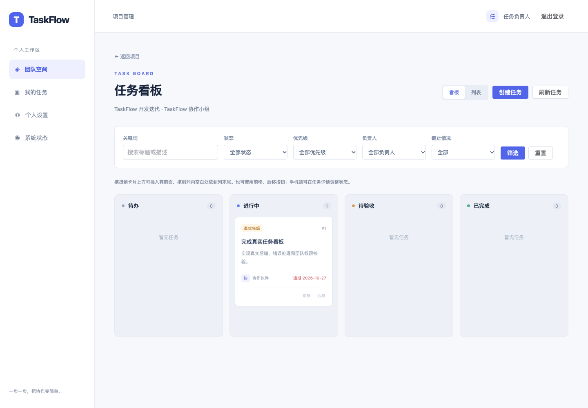

# 阶段 4 实测记录

> 此为历史阶段记录。阶段 5 已交付评论与日志查询，当前运行和验收见 [阶段 5 验收](acceptance-stage-5.md)。

日期：2026-10-31（Asia/Shanghai）。本记录区分已执行检查与手工验收建议，手工步骤详见 [阶段 4 验收](acceptance-stage-4.md)。

## 实际执行结果

| 检查 | 结果 |
|---|---|
| Go 1.27.3：go test ./... | 通过；未开启开关时，外部依赖测试明确跳过 |
| go vet ./... | 通过 |
| Docker 内 Go 服务和迁移命令构建 | 通过 |
| scripts/test-integration.sh | 独立真实 MySQL/Redis 的 23 项全部通过 |
| npm run build | Vue TypeScript 检查及 Vite 生产构建通过 |
| scripts/test-e2e.sh，使用本机 Chrome | 7 项完整浏览器回归通过，16.7 秒 |
| 最后阶段 4 浏览器定向回归 tasks.spec.ts | 3 项通过，11.8 秒；截图等待抽屉数据和动画完成 |
| OpenAPI 0.5.0 | YAML 解析和全部内部 $ref 校验通过 |
| docker compose config --quiet | 通过 |
| docker compose up --build -d | 原演示环境完成升级，migrate 为 Exited (0) |
| GET /api/v1/health/ready | HTTP 200，mysql/redis/migrations 全为 ok |
| schema_migrations 最大版本 | 8 → 10 |

Go 集成测试连接 profile=test 的 taskflow_test 数据库/独立 Redis。浏览器测试启动 compose.e2e.yaml 的独立 MySQL/Redis/应用栈，端口 18080；没有 mock、路由拦截或浏览器假数据。测试结束停止测试服务，主应用继续在 8080 运行。

## 新增真实集成覆盖

- TestTaskLifecyclePermissionsAndFilters：创建/读取/编辑/null 清空/软删除、当前成员权限、跨团队分配和读取隔离、平台角色无隐式特权、所有筛选、日期/枚举/未知字段校验。
- TestTaskOrderingAndVersionConflicts：同列和跨列移动、位置压紧、相邻任务版本、无变化移动、非法/过期目标、版本冲突和并发更新只成功一个。
- TestTaskMembershipCleanupAcrossProjects：离队和移除清理负责人，覆盖已完成及归档项目；不影响其他团队和软删除任务，保留真实日志。
- TestTaskAssignmentRemovalRaceAndArchive：并发移除/分配的一致性、项目和父团队归档只读。
- TestTaskRollbackIncludesOrderAndMembership：日志失败时回滚创建/编辑/移动/删除、排序/版本、分配清理和成员移除。
- TestBoardPaginationSnapshotAndValidation：55 条真实任务，首批 50、后续 5；旧 revision 冲突，重新读取后不重复；筛选和非法参数。
- TestTaskRevisionMigrationRecovery：模拟 ALTER 已成功、版本未记入后的恢复，重复迁移成功。

已有认证、团队和项目 16 项一并回归通过。单元测试另覆盖有效/无效日期、闰年及逾期边界。

## 浏览器实测

7 项完整回归包含原认证、移动端登录、团队、项目流程，以及以下 3 项任务流程：

1. 用真实账号建团队/加入/建项目；在页面创建并分配任务，原生拖到进行中，刷新保持；普通成员编辑、我的任务筛选、详情移到待验收；跨团队访问拒绝；创建者删除自己的任务；归档后入口只读。
2. 两个浏览器打开同一版本；一方保存后另一方收到冲突，页面载入服务器结果并可重新编辑；移除成员后我的任务清空、负责人变为未分配。
3. 55 条任务分页中另一请求修改导致快照变化，加载更多自动重载；再次加载获得 55 个不同 ID；390px 下看板、20 行列表和任务详情无整页横向溢出。

页面 JavaScript 错误也在任务完整流程中检查。抽屉截图额外等待输入值和最终 transform，避免将打开动画的首帧误当成页面完成状态。

## 原环境数据保留

升级前后读取 MySQL 实际计数：users 均为 13、teams 均为 3、projects 均为 0。新建 tasks 表为 0 行；没有往演示数据库植入测试任务。用户自行在已有团队创建项目并创建任务即可演示。原服务 MySQL/Redis 数据卷保留，测试依赖已停止。

## 真实页面截图

以下来自独立测试数据库，经实际 API 写入并在页面操作，不代表主环境预置了这些账号和任务。

- [任务详情抽屉](images/stage-4-drawer.png)
- [390px 任务列表](images/stage-4-list-mobile.png)
- [390px 任务详情](images/stage-4-detail-mobile.png)

## 当前限制

无实时推送，需刷新或冲突后重载；手机使用列表/详情调整状态；整列重排适合中小项目，超大任务量需优化。评论、统计、管理员后台和恢复删除/归档均未实现。下一模块为阶段 5：评论与操作日志体验完善。
